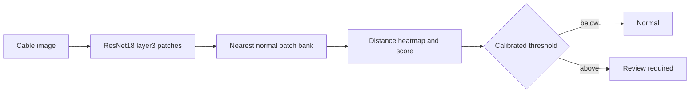

# VoltVision AI

Deep Learning for Industrial Visual Anomaly Detection. This runnable educational prototype demonstrates a normal-only visual-inspection workflow for electrical cables. It is not a Havells system, uses no Havells data, and is not deployed in a factory.

## What it does

An ImageNet-pretrained ResNet18 converts an image into local feature vectors. These spatial patch embeddings are compared against a bank made only from defect-free MVTec cable training images using Euclidean nearest-neighbor distance. The 95th-percentile local distance is the image anomaly score; a threshold selected from a separate normal validation split decides **NORMAL** or **REVIEW REQUIRED**.



## Setup

Use Python 3.10–3.13 (Python 3.14 is not yet a reliable target for the required torchvision/scientific wheels):

```powershell
py -3.13 -m venv .venv
.\.venv\Scripts\Activate.ps1
python -m pip install -r requirements.txt
```

Download only the cable subset through the active virtual environment (this avoids relying on a globally installed `hf` command). The script verifies the repository's `cable/` paths before downloading and reuses existing local/cache content where Hugging Face supports it:

```powershell
.\.venv\Scripts\python.exe scripts\download_cable_dataset.py
.\.venv\Scripts\python.exe scripts\inspect_dataset.py
.\.venv\Scripts\python.exe scripts\build_reference_bank.py
.\.venv\Scripts\python.exe scripts\evaluate.py
.\.venv\Scripts\python.exe -m streamlit run app.py
```

If the hosted repository is unavailable or requires authentication, obtain the data from the [official MVTec AD page](https://www.mvtec.com/research-teaching/datasets/mvtec-ad), then extract its `cable` folder to `data/mvtec_anomaly_detection/cable/`. Do not redistribute the data.

If data/artifacts are absent, `streamlit run app.py` still starts in explicitly labeled UI-only demo mode. It never invents evaluation results.

## Dataset and limits

The intended data is the cable category of [MVTec AD](https://www.mvtec.com/research/datasets/mvtec-ad), distributed under CC BY-NC-SA 4.0. Do not commit or redistribute data. This prototype detects visual deviation, not electrical continuity, insulation strength, voltage withstand, fire resistance, compliance, safety, or a guaranteed defect boundary. Heatmaps are approximate anomaly visualizations.

## Evaluation

The evaluation script calculates image-level precision, recall, F1, ROC-AUC (when both classes exist), confusion matrix, and latency on held-out test images. The threshold is selected without test labels. Results are saved only after a real run to `reports/evaluation.json` and `reports/confusion_matrix.png`.

## Verified local run (2026-10-13)

The cable subset was downloaded and inspected: 224 normal training images, 150 test images (58 good and 92 defect images across eight discovered categories), and 92 ground-truth masks; no invalid images were found. ResNet18 ImageNet weights loaded and a 30,000-patch capped normal reference bank was built from 179 training images. The deterministic 45-image normal validation split selected a threshold of `0.6180034255981446`.

Actual held-out image-level results: precision `1.0000`, recall `0.8261`, F1 `0.9048`, ROC-AUC `0.9936`, confusion matrix `[[58, 0], [16, 76]]`, and mean latency `84.5 ms`. These are a small single-category benchmark result, not production performance.
