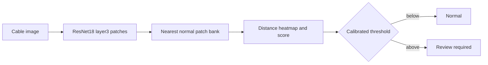

# VoltVision AI

Deep Learning for Industrial Visual Anomaly Detection. This runnable educational prototype demonstrates a normal-only visual-inspection workflow for electrical cables. It is an independent project, uses only the public MVTec AD dataset, and is not deployed in production.

## What it does

An ImageNet-pretrained ResNet18 converts an image into local feature vectors. These spatial patch embeddings are compared against a bank made only from defect-free MVTec cable training images using Euclidean nearest-neighbor distance. The 95th-percentile local distance is the image anomaly score; a threshold selected from a separate normal validation split decides **NORMAL** or **REVIEW REQUIRED**.

For explainable reference retrieval, VoltVision selects the normal source image (s) that minimizes \(S(s)=\frac{1}{N}\sum_{i=1}^{N}\min_{r\in R_s}\lVert q_i-r\rVert_2\), where \(q_i\) is a query patch and \(R_s\) is the set of retained reference patches from source image \(s\). This uses all query patches, rather than choosing an image because of one isolated nearest patch. Sources without retained patches are excluded during bank construction; exact ties use the stable relative image path.



## Setup

Use Python 3.10–3.13 (Python 3.14 is not yet a reliable target for the required torchvision/scientific wheels):

```powershell
py -3.13 -m venv .venv
.\.venv\Scripts\Activate.ps1
python -m pip install -r requirements.txt
```

`requirements.txt` gives flexible lower bounds. `requirements-lock.txt` pins the exact environment that produced the recorded results (Python 3.13.2, CPU builds of torch 2.14.1 and torchvision 0.29.1).

Download only the cable subset through the active virtual environment (this avoids relying on a globally installed `hf` command). The script verifies the repository's `cable/` paths before downloading and reuses existing local/cache content where Hugging Face supports it:

```powershell
.\.venv\Scripts\python.exe scripts\download_cable_dataset.py
.\.venv\Scripts\python.exe scripts\inspect_dataset.py
.\.venv\Scripts\python.exe scripts\build_reference_bank.py
.\.venv\Scripts\python.exe scripts\evaluate.py
.\.venv\Scripts\python.exe -m streamlit run app.py
```

If the hosted repository is unavailable or requires authentication, obtain the data from the [official MVTec AD page](https://www.mvtec.com/research-teaching/datasets/mvtec-ad), then extract its `cable` folder to `data/mvtec_anomaly_detection/cable/`. Do not redistribute the data.

If data/artifacts are absent, `streamlit run app.py` still starts in explicitly labeled UI-only demo mode. It never invents evaluation results.

Reference artifacts are validated against the dataset's content (SHA-256 manifests and a dataset fingerprint), not its location, so a cloned or moved repository with identical data keeps working. Changing the model or preprocessing settings in `config.py` requires rebuilding the bank.

Run the tests with `pytest` (configured in `pytest.ini`).

## Dataset and limits

The intended data is the cable category of [MVTec AD](https://www.mvtec.com/research/datasets/mvtec-ad), distributed under CC BY-NC-SA 4.0. Do not commit or redistribute data. This prototype detects visual deviation, not electrical continuity, insulation strength, voltage withstand, fire resistance, compliance, safety, or a guaranteed defect boundary. Heatmaps are approximate anomaly visualizations.

## Evaluation

The evaluation script calculates image-level precision, recall, F1, ROC-AUC (when both classes exist), confusion matrix, and latency on held-out test images. The threshold is selected without test labels. Results are saved only after a real run to `reports/evaluation.json` (with the artifact hashes, dataset fingerprint and package versions that produced them) and `reports/confusion_matrix.png`. Use `--output-dir` to evaluate without overwriting the recorded report.

Four research experiments (reference-bank size, score aggregation, split stability, input-condition robustness) are run with `scripts/run_research_experiments.py`; Experiment 4 can also be run in resumable chunks with `scripts/run_robustness_chunk.py` and merged with `scripts/aggregate_robustness_experiment.py`. Result sections below and in `docs/EXPERIMENTS.md` are generated from the JSON reports by `scripts/build_docs.py` (`--check` verifies they are current).

<!-- results:start (generated by scripts/build_docs.py) -->

## Results

Recorded baseline (`reports/evaluation.json`; reference bank built 2026-11-09, seed 42): 150 held-out test images, threshold `0.6180034255981446`.

| Precision | Recall | F1 | ROC-AUC | Confusion matrix [[TN, FP], [FN, TP]] | Mean latency (ms) |
|---|---|---|---|---|---|
| 1.0000 | 0.8261 | 0.9048 | 0.9936 | `[[58, 0], [16, 76]]` | 193.2 |

**Split sensitivity.** Repeating the full protocol over 10 other normal reference/validation splits (seeds 0–9) gives F1 0.9387 ± 0.0133 (range 0.9112–0.9560) and recall 0.8946 ± 0.0319. The seed-42 baseline F1 (0.9048) is below the lowest of these splits, so the multi-split mean is the better summary of expected performance.

Latency is end-to-end on CPU (image load, preprocessing, feature extraction, scoring and closest-reference retrieval) and varies with machine load. These are results on a small single-category benchmark, not production performance. Full experiment results: [docs/EXPERIMENTS.md](docs/EXPERIMENTS.md).

<!-- results:end -->
