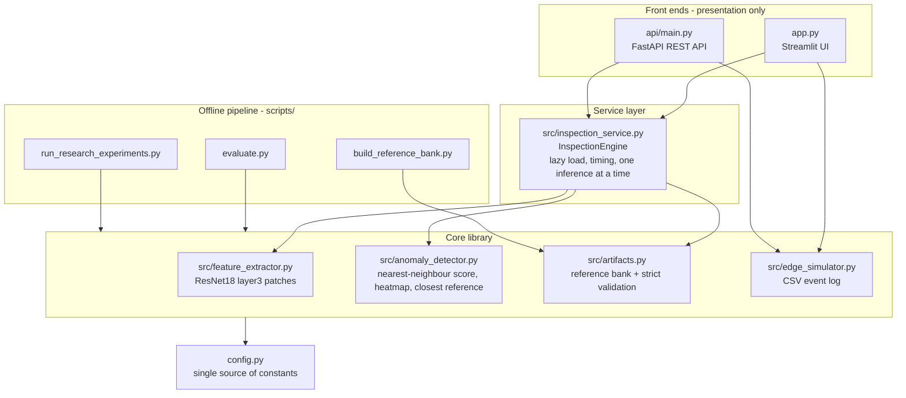

# Architecture

VoltVision AI is organised in three layers. Each layer only depends on the ones below it, so the model code never knows whether it is being called from a web page, an HTTP request or an experiment script.

## Layers

| Layer | Files | Responsibility |
|---|---|---|
| Front ends | `app.py`, `api/main.py` | Accept an image, call the engine, present the result. No model logic. |
| Service | `src/inspection_service.py` | `InspectionEngine`: loads and validates the reference bank on first use, extracts features, scores, measures latency. The only place that wires extractor + detector + artifacts together. |
| Core library | `src/*.py` | Feature extraction, scoring, artifact format and validation, labels, perturbations. |
| Offline pipeline | `scripts/` | Build the bank, evaluate, run experiments, regenerate docs. Writes to `artifacts/` and `reports/`. Uses the core library directly, not the service layer, so recorded results do not depend on front-end code. |

## Request flow (`POST /inspect`)

1. The API checks the upload (non-empty, under `VOLTVISION_MAX_UPLOAD_MB`, default 10).
2. `InspectionEngine.inspect` loads the engine if needed, then runs feature extraction, scoring and closest-reference retrieval under a lock (one inference at a time).
3. The decision is `REVIEW REQUIRED` if `score >= threshold`, else `NORMAL`.
4. The event (time, file name, score, decision, latency) is appended to `artifacts/inspection_events.csv`. A logging failure never fails the inspection.
5. The response carries the score, threshold, decision, latency, the 14x14 heatmap and the closest normal reference id.

## Status codes

| Code | Meaning |
|---|---|
| 200 | Inspection completed |
| 400 | Empty upload, or not a readable image |
| 413 | Upload larger than the limit |
| 422 | No `image` file field in the request |
| 503 | Reference bank missing, incompatible with `config.py`, or no longer matches the dataset (the message says to rebuild it) |

`GET /health` is liveness (loads nothing, always 200 while the process is up). `GET /ready` is readiness (200 only when the bank loads and validates, else 503). Both front ends start without a dataset or artifacts and report "not ready" instead of crashing.

## Deployment

The Docker image contains code and the public ImageNet weights only. The MVTec AD dataset (CC BY-NC-SA 4.0) and the reference bank are mounted at run time, never copied into the image, because the bank is validated against the dataset's contents on first use. See `Dockerfile` and `docker-compose.yml`.

Constraints worth knowing:
- Run **one worker**. The bank is held in memory per process, and the event log is a CSV file with no cross-process locking.
- The event log and API have no authentication. Put them behind a trusted network or reverse proxy before exposing them.
- Latency is dominated by `closest_reference_image` (a dense query-by-bank distance matrix); see the README for recorded numbers.

## What stays unchanged

The scientific method (ResNet18 `layer3`, Euclidean 1-NN, 95th-percentile image score, threshold at the 99th percentile of normal validation scores) and the artifact contract are unchanged. Nothing in this layering touches `config.py`, `artifacts/`, `reports/evaluation.json` or `reports/experiments/`.
